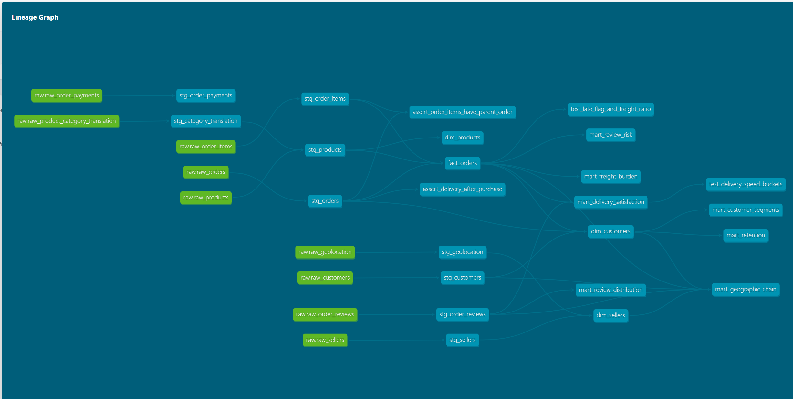

# BrazilCommerce 360

Olist is a Brazilian marketplace that connects small sellers to the country's large
e-commerce platforms. Sellers list through Olist; Olist arranges the logistics. That
creates the problem every marketplace has — it is judged on a delivery experience it does
not directly control.

**The question: what actually drives customer dissatisfaction, and what could Olist change
about it?** Written for whoever decides where the next operations or marketing spend goes.

An end-to-end pipeline answering that question across 99,441 orders: raw CSVs → validated
ingestion → tested dbt models → predictive analysis → orchestrated, CI-gated pipeline →
live dashboard.

**Stack:** Snowflake · dbt · Python · Streamlit · GitHub Actions

> 🔗 **Live dashboard:** <https://brazilcommerce-360.streamlit.app/>
> 📊 **dbt docs & lineage:** <https://hannah-vp.github.io/brazilcommerce-360/>

---

## The data

| | |
|---|---|
| **Source** | [Brazilian E-Commerce Public Dataset by Olist](https://www.kaggle.com/datasets/olistbr/brazilian-ecommerce) (Kaggle) |
| **Licence** | CC BY-NC-SA 4.0 — attribution, non-commercial, share-alike |
| **Period** | September 2016 – October 2018 |
| **Size** | 9 tables · 1,550,922 rows · 99,441 orders · 96,096 customers |
| **Grain** | one row per order *item* — `order_id` repeats |
| **Nature** | a fixed historical export, not a live feed |

Real anonymised transactions: orders, items, payments, reviews, customers, sellers,
products and geolocation, joinable into a complete order lifecycle.



---

## The finding

**Breaking a delivery promise costs 1.7 stars — and raw speed barely matters.**

Olist pads its delivery estimates, and it works: the 92% of orders that beat the quoted
date average 4.29★ and draw a bad review 9.2% of the time. The 8% that miss an
already-generous estimate average 2.57★ and draw a bad review **54.0%** of the time — a
**5.9× difference**.

The geography confirms it. Amapá is the slowest state in the country at 27 days and still
scores 4.24★, because only 4.5% of its orders arrive late. Alagoas is *faster* at 24 days
and still sits at the bottom of the table on 3.84★, because 23% miss the promise. Distance
is survivable when the estimate is honest.

Because **96.95% of customers never place a second order**, that review is the last
interaction. There is no repeat purchase in which to recover them.

**The lever is the promise, not the parcel.** Recalibrating delivery estimates per state
from observed performance is a pricing-page change, not a logistics investment, and it
addresses the largest single driver of dissatisfaction in the dataset.

### The other four

| Finding | What it means |
|---|---|
| **There is no retention flywheel** | 96.95% of customers order exactly once. First-order reliability returns more than any retention campaign, because there is no retention behaviour to amplify. |
| **Value is concentrated, but not by loyalty** | The top 11% of customers drive **41.2%** of revenue — at 1.09 orders each, against 1.01 for the bottom half. They buy once, much bigger. Don't build a loyalty programme against that. |
| **The average review score is a misleading KPI** | Reviews are bimodal: 1-star (11.5%) outnumbers 2- and 3-star combined (11.4%). The mean of 4.09 describes almost no real order, and can hold steady while 1-star climbs. Track %-1-star instead. |
| **Revenue rankings hide the margin picture** | Freight runs from 4.4% of item price (computers) to 36.7% (christmas supplies). `watches_gifts` is the second-largest category *and* freight-efficient at 8.3%; `office_furniture` earns well but loses 25% to shipping. Rank categories by margin after freight. |

Full analysis: [`docs/executive_analysis.md`](docs/executive_analysis.md)

---

## Architecture

```
9 CSVs ──▶ Python ingestion ──▶ Snowflake RAW ──▶ dbt staging ──▶ dbt marts ──▶ Streamlit
           validate + quarantine   VARCHAR,        clean, typed,    star schema    5 findings,
           vectorised              source-faithful  deduplicated    + 7 insights   each with
                                                                                   an action

                    Snowflake Tasks: freshness → quality gate → reconciliation
                    GitHub Actions: dbt build + 123 tests on every pull request
```

**Layers.** RAW mirrors the source exactly — all VARCHAR, nothing cleaned, so a malformed
value can never fail the load. STAGING casts, deduplicates and applies every fix from the
data quality register. MART holds a star schema plus one model per business question, so
the dashboard reads answers rather than computing them.

---

## The four questions

Every model traces back to one of these. Anything that didn't answer one was cut.

| Theme | Question |
|---|---|
| **Retention** | What share of customers return, and what distinguishes them? |
| **Delivery** | How does delivery affect satisfaction, and which states are worst? |
| **Geography** | Where are customers and sellers concentrated, and where is demand underserved? |
| **Revenue** | Which categories drive GMV, and what does freight do to margin? |

---

## How it was built

### Phase 0 — Foundation
Snowflake environment with separate `ECOMMERCE_DEV` and `ECOMMERCE_PROD` databases, a
least-privilege `transformer` role rather than SYSADMIN, and a resource monitor capping
daily credit spend. Repo initialised with a secrets-blocking `.gitignore` before any
credentials file existed.

### Phase 1 — Ingestion
`ingestion/load.py` loads 9 CSVs into RAW with vectorised Pydantic-style validation.
Rows failing validation go to a `_QUARANTINE` table rather than being dropped silently.
Blank source cells load as SQL `NULL`, and column names are upper-cased so no downstream
query needs quoted identifiers. Validating the 1M-row geolocation file takes ~4 seconds.

### Phase 2 — Profiling and diagnosis
Automated profiling with `ydata-profiling`, then targeted SQL for the questions a
single-table profiler structurally cannot answer.

The split mattered. Automated profiling reported that `raw_order_items` has 112,650 rows
and 98,666 distinct `order_id` — but never compared the two, because it has no way to know
`order_id` was *intended* to be one per row. The same blind spot hid 814 rows sharing a
review key and a 53× geolocation fan-out. Every finding that required comparing two numbers came
from hand-written SQL.

Output: [`docs/data_quality_notes.md`](docs/data_quality_notes.md) — 12 findings, each
labelled keep / flag / fix, each fix naming the dbt test that would enforce it.

### Phase 3 — Transformation
20 dbt models across three layers, with **123 tests** covering:

- generic tests (`unique`, `not_null`, `relationships`, `accepted_values`)
- package tests (`dbt_utils.unique_combination_of_columns`, `dbt_expectations` ranges)
- **unit tests** asserting transformation *logic* against known input — the late-delivery
  flag, freight ratio, and delivery bucketing at its exact boundaries
- singular tests for rules spanning models

`fact_orders` is incremental, clustered by purchase month, and **contract-enforced**, so a
column rename fails the build rather than silently breaking the dashboard.

`stg_order_reviews` is grained on `(review_id, order_id)` rather than `review_id`. 814 rows
share a review ID, and every one of those pairs sits on a *different* order — so
deduplicating on the ID alone deleted 550 orders' reviews while the `unique` test on
`review_id` kept passing, because the deletion was what satisfied it. The test was
validating the output of the bug rather than the input to it.

### Phase 4 — Analysis and modelling
Five findings framed as effect sizes rather than correlations, each ending in a
recommendation. Plus a logistic regression predicting bad reviews, trained on 96,353
orders from the marts.

Its **Very High** bucket holds ~8,200 orders where 52% actually leave a bad review — four
times the base rate. The model artifact and metrics are persisted to
`analysis/artifacts/`, and per-order scores are written back to Snowflake.

### Phase 5 — Orchestration and CI
A Snowflake Task DAG chains freshness check → quality gate → reconciliation, writing to a
`pipeline_run_log` table. A child task runs only if its parent succeeded, so a failed load
cannot propagate.

GitHub Actions builds and tests every pull request against an isolated `ci_pr_<n>` schema,
then drops it. Pre-commit hooks block private keys, large files and malformed YAML before
a commit is even created.

### Phase 6 — Dashboard
Streamlit reads the insight marts. No business logic in the app — every chart carries a
caption stating the takeaway *and* the action, because a chart without a "so what" is
decoration. Caption figures are read off the data rather than typed in, so they cannot
drift from the chart beside them.

**Two sources, one set of charts.** The app queries Snowflake when `[snowflake]`
credentials are present, and falls back to a committed CSV snapshot of the same marts when
they are not — which is how the public deployment runs. The header states which source it
read, because a dashboard quietly serving stale figures as live ones is worse than one
that admits what it is reading. Credentials that are present but fail degrade to the
snapshot with a visible warning rather than a stack trace.

The Snowflake trial behind this project expired after the build. Rather than leave a dead
link, [`analysis/build_snapshot.py`](analysis/build_snapshot.py) regenerates the marts
from the raw CSVs using the same logic as the dbt models — a second implementation, not an
export. Every known difference between the two is recorded in
[`data/marts/README.md`](data/marts/README.md).

---

## The through-line

The orphan check — *does every order item have a parent order?* — appears three times in
this project:

1. **Phase 2:** a manual SQL query, run once during diagnosis
2. **Phase 3:** a dbt test, run automatically on every build
3. **Phase 5:** a scheduled gate that halts the pipeline and logs a failure

Same check, three levels of automation. That progression is the difference between
analysing data once and maintaining a dataset.

---

## Running it

```bash
git clone https://github.com/hannah-vp/brazilcommerce-360.git
cd brazilcommerce-360

python -m venv .venv
.venv/Scripts/Activate.ps1                          # PowerShell; source .venv/bin/activate on Unix
pip install -r requirements.txt

cp .env.example .env                                # fill in Snowflake credentials

# 1. environment
#    run sql/00_setup.sql and sql/00b_upgrade.sql in a Snowflake worksheet

# 2. ingest
python ingestion/load.py --data-dir ./data

# 3. transform
cd olist_dbt && dbt deps && dbt build && dbt docs generate && cd ..

# 4. model
python analysis/risk_model.py

# 5. dashboard
streamlit run streamlit/app.py     # reads the committed snapshot without step 1-4
```

Steps 1–4 need a Snowflake account. Step 5 does not: with no credentials configured the
dashboard reads `data/marts/`, which is committed.

Dataset: [Olist on Kaggle](https://www.kaggle.com/datasets/olistbr/brazilian-ecommerce).
Place the 9 CSVs in `data/`.

---

## Repo structure

```
├── ingestion/load.py              validated CSV → RAW
├── sql/                           environment, profiling, orchestration, cost
├── olist_dbt/
│   ├── models/staging/            9 models — one per source, every fix applied
│   ├── models/marts/core/         fact_orders + 3 dimensions
│   ├── models/marts/insights/     7 models — one per business question
│   └── tests/                     singular tests
├── analysis/risk_model.py         bad-review prediction
├── analysis/build_snapshot.py     regenerates data/marts/ from the raw CSVs
├── data/marts/                    committed mart snapshot for the public deployment
├── streamlit/app.py               dashboard
├── profiling/profile_raw.py       automated profiling
├── docs/
│   ├── data_quality_notes.md      the 12-finding register
│   ├── executive_analysis.md      the five findings
│   └── lineage.png
└── .github/workflows/dbt_ci.yml   CI
```

---

## Design decisions

**ELT, not ETL.** Load raw first, transform in the warehouse. RAW stays a faithful mirror
of the source, and all transformation logic lives in one version-controlled place.

**Fact grain is one row per order item.** The most granular level available — you can
always aggregate up, never disaggregate down. `order_id` therefore repeats, so order
counts use `count(distinct order_id)`. This is the trap the profiler missed and the most
common error in e-commerce analytics.

**`customer_unique_id`, not `customer_id`.** Olist issues a new `customer_id` per order.
Keying customer analysis on it would report a repeat rate of zero. 99,441 order-records
map to 96,096 actual people.

**Interpretability over accuracy.** Logistic regression was chosen over a gradient-boosted
model deliberately. A tree would likely score a few points higher and would not produce
the "3.49× odds" figure that supports the recommendation.

**Business logic in dbt, not the dashboard.** The app runs `select * from mart_retention`
and draws a chart. The definition of a repeat customer lives in a tested, documented model
— not in a Python string.

---

## Known limitations and what I'd do differently

**Static source data.** The Olist dataset is a fixed historical export, so ingestion is a
one-time truncate-and-replace. With a live source I'd use Snowpipe for file auto-ingestion
or Fivetran/Airbyte for SaaS connectors, and the incremental strategy already demonstrated
in `fact_orders`.

**Custom validation script.** `load.py` implements validate-and-quarantine explicitly to
show the pattern. In production I'd delegate this to Great Expectations or Soda rather
than maintaining bespoke rules.

**Password authentication.** Credentials are environment variables. Key-pair auth would be
correct for anything beyond a portfolio project, and Snowflake is deprecating
single-factor password auth for programmatic access.

**Single-node orchestration.** Snowflake Tasks keep everything in-platform and free. At
scale, Airflow or Dagster would give better observability, retries and cross-system
dependencies. dbt itself runs from CI rather than inside a Task — keeping that boundary
clean was deliberate.

**Model performance is modest.** Test ROC AUC 0.684 against a 12.8% base rate, reported
as-is. Refitting on the regenerated snapshot gives 0.697 on the same features, split and
seed; the app shows whichever belongs to the source it read. The model is useful because of where its confidence concentrates — the Very High
bucket — not because of overall discrimination. It also produces no Low bucket, so it
separates high risk from ordinary risk rather than high from negligible.

**Reconciliation expects a mismatch.** `fact_orders` inner-joins to order items, so 775
orders with no line item are absent by design. The pipeline alarms on a *change* to that
gap rather than on the gap itself.

**Trend analysis is trimmed to Jan 2017 – Aug 2018.** The dataset's first and last months
are sparse and would otherwise read as a collapse in demand.

**Reviews predating delivery.** 8,320 reviews were created before the order arrived,
because Olist requests the review at dispatch. Documented rather than filtered — the rows
are valid and reflect real business behaviour.

---

## What I learned

The hard part was not building the pipeline, it was trusting it. Twice I had models that
were wrong while every test passed: 676 customers silently dropped from the customer
dimension, and a review deduplication that deleted 550 orders' reviews and was then
validated by the very `unique` test the deletion satisfied. A test checks the assertion you
thought to write. It cannot tell you the assertion was about the wrong column.

The dataset punished assumptions about keys. `customer_id` is issued per order rather than
per person, so grouping on it reports a repeat rate of exactly zero. `review_id` is not
unique either — and the standard remedy, keeping the latest row per ID, was the wrong
remedy, because those duplicates differed on `order_id`. Neither was caught by a test. Both
were caught by reconciling a model against an independent calculation.

What I would do differently: profile the shape of a key before trusting it, and write the
reconciliation query at the same time as the model rather than after it. I would also pin
tool versions from the first commit — an alpha release of dbt landed mid-project and broke
YAML that had worked the week before.

---

*Every figure in this project was computed from the source data and is reproducible from
the code in this repo. Dataset © Olist, used under CC BY-NC-SA 4.0.*
