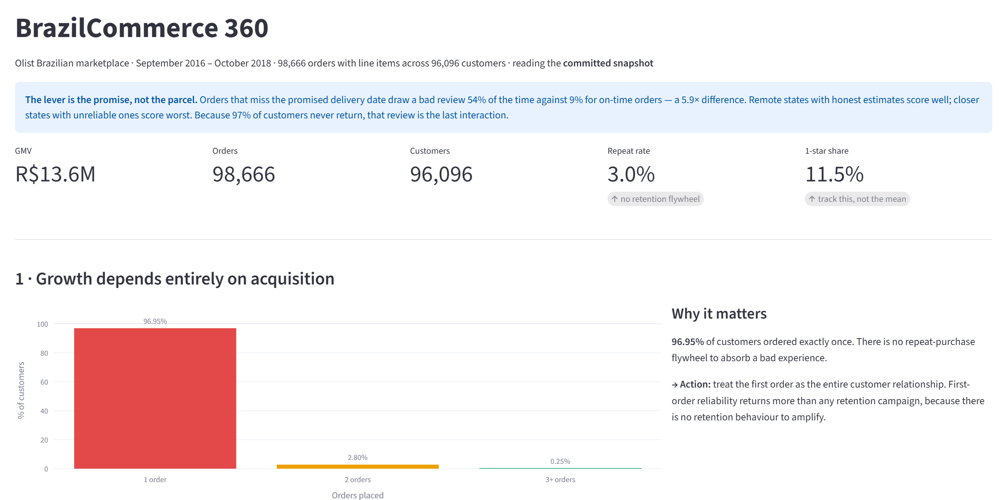
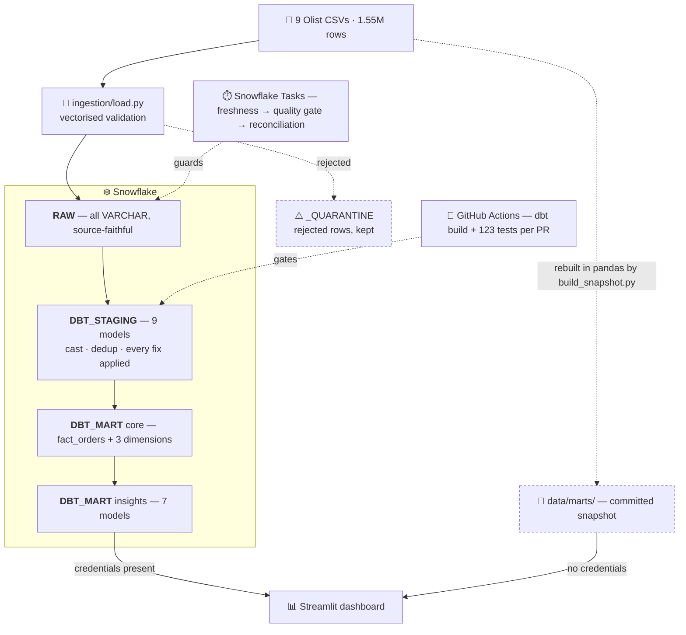

# BrazilCommerce 360

### An ELT pipeline on 99,441 Brazilian e-commerce orders, built to answer one question

Olist is a Brazilian marketplace that connects small sellers to the country's large e-commerce platforms. It arranges the logistics it gets judged on but does not directly control them — which makes **what actually drives customer dissatisfaction** a question worth answering carefully.

The answer is counterintuitive: **breaking a delivery promise costs 1.7 stars, and raw delivery speed barely matters.**

🔗 **[Live dashboard](https://brazilcommerce-360.streamlit.app/)** &nbsp;·&nbsp; 📊 **[dbt docs & lineage](https://hannah-vp.github.io/brazilcommerce-360/)**


[](https://brazilcommerce-360.streamlit.app/)

---

## The data

| | |
|---|---|
| **Source** | [Brazilian E-Commerce Public Dataset by Olist](https://www.kaggle.com/datasets/olistbr/brazilian-ecommerce) (Kaggle) |
| **Licence** | CC BY-NC-SA 4.0 — attribution, non-commercial, share-alike |
| **Period** | September 2016 – October 2018 |
| **Size** | 9 tables · 1,550,922 rows · 99,441 orders · 96,096 customers |
| **Nature** | a fixed historical export, not a live feed |

Real anonymised transactions covering orders, items, payments, reviews, customers, sellers, products and geolocation.

### How the counts narrow

Several figures below are smaller than 99,441. Each drop is deliberate and the reason is recorded.

| Population | Orders | Why it narrows |
|---|---|---|
| Orders in the source file | **99,441** | — |
| Orders reaching `fact_orders` | **98,666** | 775 orders carry no line item, and the fact table joins to items |
| Delivered orders with a review | **96,353** | undelivered orders have no delivery time to measure |

The same thing happens on the customer side: 96,096 people, of whom **95,420** have at least one order that reaches `fact_orders`. The 676 missing are the people whose only orders are among those 775 — the same gap seen from the other end. Customer percentages below are shares of the 95,420.

---

## Architecture



RAW, STAGING and MART are the Snowflake schema names; they correspond to the bronze, silver and gold layers of the medallion pattern.

### Why ELT, not ETL

**Load first, transform in the warehouse.**

RAW stays a faithful mirror — every column lands as `VARCHAR`, uncleaned, so a malformed value can never fail the load, and there is always an untouched copy to reconcile a suspect figure against. Transformation logic then lives in one version-controlled place: cleaning inside the ingestion script would scatter the rules through Python where no test can see them, while in dbt they are SQL, reviewed in pull requests and covered by assertions.

The division of labour follows: Python validates and lands files, Snowflake does the joins and window functions over 1.55M rows.

---

## The data model

Nine relational files become a star schema at order-item grain, plus seven insight models that each answer one business question.

```
   dim_customers        dim_products        dim_sellers
   (person grain)       (category EN)       (geo-joined)
         │                    │                   │
         └────────────────────┼───────────────────┘
                              ▼
                      ⭐  fact_orders
              one row per (order_id, order_item_seq)
              incremental · clustered by purchase month
              contract-enforced
                              │
                              ▼
          7 insight models — retention, delivery satisfaction,
          geographic chain, customer segments, review
          distribution, freight burden, review risk
```

### Three grain decisions

**`fact_orders` is one row per order *item*.** The source holds 112,650 rows across 98,666 orders, so `COUNT(*)` overstates order volume by **14%**. Automated profiling never flags this — it analyses columns in isolation, and the error only appears when two numbers sit side by side. The fact table keeps the most granular level available, because you can aggregate up but never disaggregate down. Every order count uses `COUNT(DISTINCT order_id)`, enforced by `dbt_utils.unique_combination_of_columns` on the pair.

**`dim_customers` is keyed on `customer_unique_id`.** Olist issues a fresh `customer_id` per order — 99,441 of them map to 96,096 people. Keying the dimension the obvious way reports a repeat rate of exactly **zero** instead of 3.05%.

**`stg_order_reviews` is grained on `(review_id, order_id)`.** 814 rows share a review ID, but each of those pairs sits on a *different* order, and the pair is unique across all 99,224 source rows. Deduplicating on the ID alone deleted 814 legitimate rows and left **550 orders with no review** — while the `unique` test on `review_id` kept passing, because the deletion was precisely what satisfied it.

> **The test was validating the output of the bug rather than the input to it.**

### One check, three levels of automation

*Does every order item have a parent order?* appears three times in this repo: as a hand-written SQL query during profiling, as `assert_order_items_have_parent_order.sql` running on every build and every pull request, and as a Snowflake task that halts the DAG and writes to `pipeline_run_log` on a schedule. Same assertion, three levels of automation — which is the difference between analysing a dataset once and maintaining one.

---

## Stack

| Function | Tools | Detail |
|---|---|---|
| **Ingestion** | Python 3.12 · pandas · `snowflake-connector-python` | Vectorised validation; rejected rows go to `_QUARANTINE` tables rather than being dropped, because a rejected row is inspectable and a dropped row is invisible. The 1M-row geolocation file validates in about 4 seconds. |
| **Storage** | Snowflake | Separate `ECOMMERCE_DEV` / `ECOMMERCE_PROD`, a dedicated `transformer` role rather than running everything as `SYSADMIN`, and a resource monitor capping spend at 5 credits a day. |
| **Transformation** | dbt 1.9 · SQL | 20 models across three layers, with **123 tests**: generic, `dbt_utils` and `dbt_expectations` package tests, unit tests asserting transformation logic at its boundaries, and two singular tests spanning models. `fact_orders` is contract-enforced, so a column rename fails the build rather than silently breaking the dashboard. |
| **Orchestration** | Snowflake Tasks · GitHub Actions | A Task DAG chains freshness → quality gate → reconciliation, each child gated on its parent, logging to `pipeline_run_log`. CI builds every pull request into an isolated `ci_pr_<n>` schema, runs the full test suite, then drops it. |
| **Analysis** | scikit-learn | Logistic regression over features available at delivery time, chosen over a boosted tree because coefficients convert to odds ratios and a recommendation needs an explanation. |
| **Dashboard** | Streamlit · Plotly | Reads the insight marts. Caption figures are read from the data rather than written into the text. |
| **Quality gates** | pre-commit · SQLFluff | Private keys, large files and malformed YAML blocked before a commit exists; SQL linted to one style. |

---

## Repo layout

```
├── ingestion/load.py              9 CSVs → RAW, validated, failures quarantined
├── profiling/profile_raw.py       automated column profiling
├── sql/
│   ├── 00_setup.sql               databases, schemas, warehouse, resource monitor
│   ├── 00b_upgrade.sql            transformer role, grants, task privileges
│   ├── 01_profile.sql             the targeted queries a column profiler cannot answer
│   ├── 02_final_checks.sql        reconciliation
│   ├── 05_orchestration.sql       the Task DAG + pipeline_run_log
│   └── 05_cost_tracking.sql       credit usage by warehouse
├── olist_dbt/
│   ├── models/staging/            9 models — one per source
│   ├── models/marts/core/         fact_orders + dim_customers / products / sellers
│   ├── models/marts/insights/     7 models — one per business question
│   └── tests/                     2 singular tests
├── analysis/
│   ├── risk_model.py              fits, scores, writes back to Snowflake
│   └── build_snapshot.py          rebuilds data/marts/ from the raw CSVs
├── streamlit/app.py               the dashboard
├── data/marts/                    committed snapshot (44 KB) + its own README
├── docs/
│   ├── data_quality_notes.md      13 findings, each with its decision and its test
│   ├── BUILD_DOCUMENTATION.md     the build log, including every error
│   └── executive_analysis.md      the five findings in full
└── .github/workflows/dbt_ci.yml   build + tests on every pull request
```

The two files worth opening first are `models/marts/core/fact_orders.sql` for the grain decision and `models/staging/stg_order_reviews.sql` for the dedup one.

---

## Running it

**Clone and launch — no Snowflake account required.**

```bash
git clone https://github.com/hannah-vp/brazilcommerce-360.git
cd brazilcommerce-360

python -m venv .venv
.venv/Scripts/Activate.ps1          # PowerShell; source .venv/bin/activate on macOS/Linux
pip install -r requirements.txt

streamlit run streamlit/app.py
```

The dashboard reads the committed snapshot in `data/marts/` and opens immediately.

**To rebuild the warehouse from source**, download the [nine Olist CSVs](https://www.kaggle.com/datasets/olistbr/brazilian-ecommerce) into `data/`, fill in `.env` from `.env.example`, then:

```bash
# in a Snowflake worksheet: sql/00_setup.sql, then sql/00b_upgrade.sql

python ingestion/load.py --data-dir ./data      # 9 CSVs → RAW
cd olist_dbt && dbt deps && dbt build && cd ..  # 20 models, 123 tests
python analysis/risk_model.py                   # fit, score, write back

# then sql/05_orchestration.sql for the Task DAG
```

To point the dashboard at Snowflake instead of the snapshot, add `streamlit/.streamlit/secrets.toml`:

```toml
[snowflake]
account   = "xy12345.us-east-1"
user      = "your_username"
password  = "your_password"
role      = "transformer"
warehouse = "ECOMMERCE_WH"
database  = "ECOMMERCE_DEV"
schema    = "DBT_MART"
```

> **Both `.env` and `secrets.toml` must stay untracked.** `.gitignore` carries `**/secrets.toml` and `**/.env`; the `**/` prefix matters, because a root-only path silently fails to match a nested file. An earlier version lacked it, and `secrets.toml` appeared in `git status` staged for what became a public repo — caught only by reading that output before committing. Verify with `git check-ignore -v streamlit/.streamlit/secrets.toml`, where silence means the file is **not** ignored.
>
> dbt reads the same values through `env_var()`, so no credential is written into `profiles.yml`.

`data/` is gitignored except `data/marts/`, which is committed deliberately: the raw files are 100 MB+ and reproducible from Kaggle, while the 44 KB snapshot is what makes the public dashboard work.

---

## What it found

**Breaking a delivery promise costs 1.7 stars. Raw speed barely matters.**

| | Orders | Avg review | Bad reviews (1–2★) |
|---|---|---|---|
| On time or early | 88,653 | 4.29★ | **9.2%** |
| Late vs promise | 7,700 | 2.57★ | **54.0%** |

A **5.9× difference** across 96,353 orders. Olist already pads its estimates and it works — 92% of orders beat the quoted date. The damage sits in the 8% that miss an already-generous one.

Measured by raw speed instead, satisfaction slopes gently: 4.41★ in the first week down to 3.06★ past three weeks. The promise split is a cliff. The two views use the same orders.

### Geography

Across the 26 states with 50 or more orders, delivery time and review score move against each other: Pearson **−0.40** unweighted, **−0.83** weighted by order volume. The gap between those two numbers is São Paulo's 40,266 orders pulling the weighted figure, which is why neither is the evidence for the finding — the 96,353-order promise split above is. What the states add is the mechanism.

| State | Orders | Avg days | Avg review | % late |
|---|---|---|---|---|
| Amapá | 66 | 27.1 | 4.24★ | 4.5% |
| Amazonas | 144 | 26.2 | 4.22★ | 4.1% |
| Alagoas | 394 | 24.4 | 3.84★ | 23.4% |
| Maranhão | 712 | 21.3 | 3.84★ | 19.1% |
| Piauí | 471 | 19.4 | 4.00★ | 15.9% |
| São Paulo | 40,266 | 8.7 | 4.25★ | 5.8% |

Alagoas is **faster** than Amapá and scores a third of a star worse, because 23% of its orders miss the promise against 4.5%. Distance is survivable when the estimate is honest.

Amapá and Amazonas are illustrations, not evidence — at 66 and 144 orders their late-rates carry 95% intervals of roughly ±5 and ±3 points. Alagoas (394 orders), Piauí (471) and Maranhão (712) are well enough powered to act on.

### The recommendation

Recalibrate delivery estimates per state from observed performance rather than a national default. For Alagoas, Maranhão and Piauí that is a **pricing-page change, not a logistics investment** — and it addresses the largest single driver of dissatisfaction in the dataset.

### The other findings

| | |
|---|---|
| **No retention flywheel** | 92,507 customers — **96.95%** — order exactly once. There is no second transaction in which to recover a bad first experience. |
| **Value is concentrated, but not by loyalty** | The top 11% of customers drive **41.2%** of revenue at 1.09 orders each, against 1.01 for the bottom half. They buy once, much bigger. |
| **The mean review score hides the signal** | Reviews are bimodal: 1-star (11.5%) outnumbers 2- and 3-star combined (11.4%). Track %-1-star, not the average. |
| **Revenue rankings hide margin** | Freight runs from 4.4% of item price (computers) to 36.7% (christmas supplies). `watches_gifts` is the second-largest category *and* freight-efficient at 8.3%. |

Full write-up in [`docs/executive_analysis.md`](docs/executive_analysis.md). Five of the seven insight models back the five findings above; the sixth carries the freight analysis and the seventh feeds the risk model below.

### On the dashboard

A KPI row — GMV R$13.59M, 98,666 orders, 96,096 customers, 4.09★ average, 11.5% one-star, 3.05% repeat — then one section per finding plus the risk model, six in all: retention, delivery satisfaction (promise and speed side by side), the geographic chain, customer value segments, the review distribution, and the risk buckets. Each chart carries a caption stating the takeaway *and* the action, with its figures read from the data rather than typed into the text — so a rebuild that changes a number changes the caption too.

---

## The risk model

Logistic regression on 96,353 orders, using features available at delivery time, predicting whether an order draws a 1- or 2-star review.

| Feature | Odds ratio |
|---|---|
| `is_late` | **3.49×** |
| `days_late` | 1.07× |
| `delivery_days` | 1.04× |
| `freight_ratio` | 1.03× |

Lateness dominates and the rest sit near neutral. That is the finding, not a limitation of the model — it is not slowness that predicts a bad review, it is a missed commitment.

**How much of the model is just the lateness flag?** Most of it, and the gap is worth stating. On the same held-out split:

| | Held-out ROC AUC |
|---|---|
| `is_late` alone | 0.651 |
| All four features | **0.697** |

Three additional features buy 0.046 against a 12.8% base rate. Real, and modest. (The warehouse run reports 0.684 on its own split; the figures in this section come from the reproducible refit in `data/marts/`, so the comparison is like-for-like.)

**Where the model earns its place** is not overall discrimination but where its confidence concentrates. On the held-out 25%:

| Predicted bucket | Orders | Actually bad |
|---|---|---|
| Medium | 12,253 | 7.7% |
| High | 9,805 | 10.8% |
| **Very High** | **2,031** | **53.4%** |

Four times the base rate, and the held-out rate is slightly *better* than the in-sample one. Scored across all 96,353 orders the Very High bucket holds **8,166** — a tractable volume for service recovery. The model produces no Low bucket at all: it separates high risk from ordinary risk, not high from negligible.

---

## What building it taught me

**The hard part was not building the pipeline — it was trusting it.** Twice a model was wrong while every test passed: 676 customers silently dropped from the customer dimension, and the review dedup described above. Both were caught by reconciling a model against an independent calculation, not by a test. A test only checks the assertion you thought to write, and in the dedup case the assertion was about the wrong column.

**A suspiciously clean result deserves more scrutiny than a messy one.** The loader quarantined zero rows and null checks came back empty across every column — which looked like unusually clean data, and wasn't. `pandas` was reading blank cells as the string `""` rather than `NaN`, so `COUNT()` counted them and every null check passed vacuously. One `keep_default_na=False` separated a profile that described the data from one that described my assumptions.

**Automated tools find where to look; judgment decides what it means.** The profiler had every number needed to catch the grain trap and printed none of the comparisons, because anything requiring two figures side by side was structurally invisible to it.

[`docs/BUILD_DOCUMENTATION.md`](docs/BUILD_DOCUMENTATION.md) is the full build log, including each of the 25 errors worked through along the way — `EXECUTE TASK privilege must be granted`, `Cannot perform RESOLVE, no current database`, an alpha release of dbt installing silently and breaking YAML that had worked the week before. It carries dated corrections where later work proved an earlier conclusion wrong.

---

## Limits and what comes next

| Limit | Why | Next |
|---|---|---|
| **Static source** | Olist is a fixed export, so ingestion is truncate-and-replace and `fact_orders`' incremental logic has never been exercised against new arrivals. | Snowpipe or a CDC connector, which is where the incremental strategy starts paying. |
| **Nothing rebuilds the marts on a schedule** | The Task DAG validates and reconciles; dbt runs from CI. Keeping that boundary clean was deliberate, but it means `DBT_MART` refreshes only when a build is triggered. | dbt Cloud, or Airflow invoking dbt, once the source justifies it. |
| **The public dashboard bypasses dbt** | `build_snapshot.py` rebuilds the marts from the raw CSVs in pandas, so the deployed figures come from a second implementation that the dbt test suite does not cover. Differences are recorded in [`data/marts/README.md`](data/marts/README.md). | A snapshot exported from the warehouse, once there is a warehouse to export from. |
| **Custom validation** | `load.py` implements validate-and-quarantine explicitly, to show the pattern. Zero rows have ever been quarantined, so the path is unproven. | Great Expectations or Soda, plus a test that deliberately feeds a bad row through. |
| **Password authentication** | Credentials are environment variables. | Key-pair auth; Snowflake is deprecating single-factor password auth for programmatic access. |
| **Reconciliation expects a mismatch** | `fact_orders` inner-joins to items, so 775 item-less orders are absent by design. The pipeline alarms on a *change* to that gap, not the gap itself. | Correct as built, not a gap to close. |
| **Snowflake-specific SQL** | Staging uses `TRY_TO_TIMESTAMP`, `TRY_TO_DECIMAL` and `QUALIFY`. | Isolate adapter-specific functions to staging and port to BigQuery. |

---

## Built by

**Ha (Hannah) Phan** — data analytics and engineering.
[LinkedIn](https://www.linkedin.com/in/ha-v-phan/) · [GitHub](https://github.com/hannah-vp) · havo1302@gmail.com

---

*Every figure here was computed from the source data and is reproducible from the code in this repo. Dataset © Olist, used under CC BY-NC-SA 4.0.*
